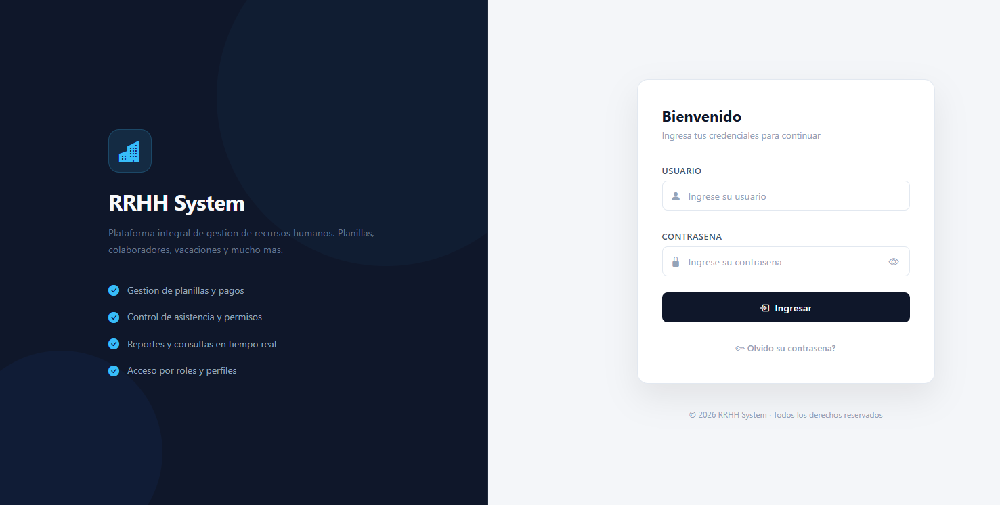
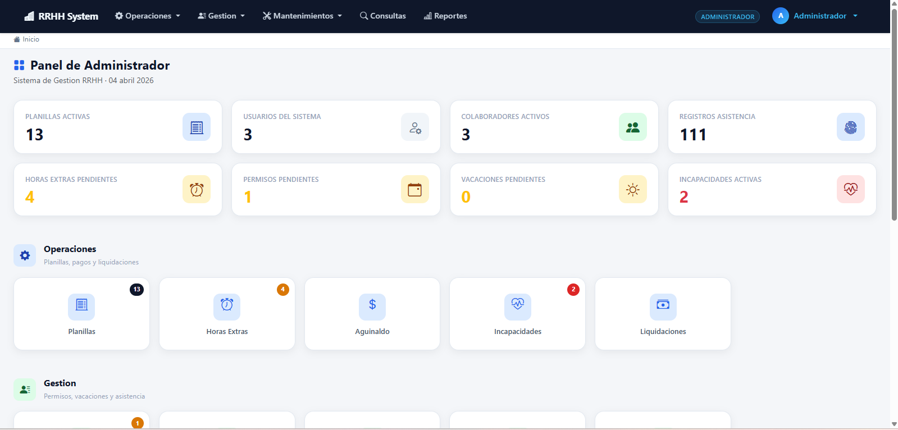
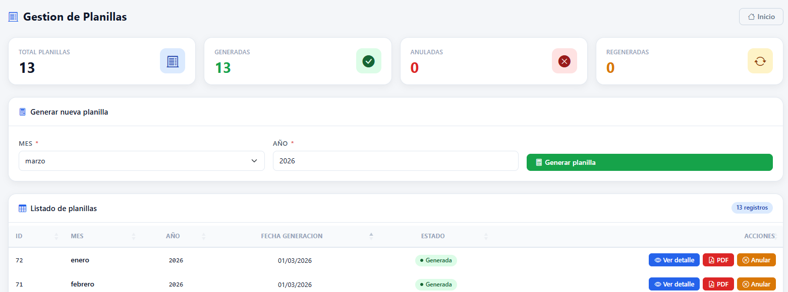
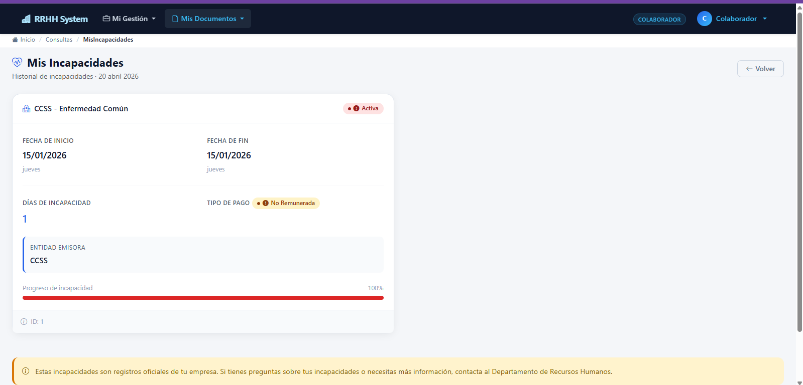

# 🏢 RRHH System — Sistema de Gestión de Recursos Humanos

Sistema integral de gestión administrativa de recursos humanos desarrollado en **ASP.NET MVC con arquitectura en capas**. Automatiza procesos clave del departamento de RRHH siguiendo la normativa del Código de Trabajo de Costa Rica.

## ✨ Funcionalidades

- **Gestión de Colaboradores** — Registro y administración de empleados con validación de cédula única
- **Nómina / Planillas** — Generación automática con cálculos de deducciones (CCSS, IVM, Renta, INS), horas extras, feriados, incapacidades y aguinaldo
- **Asistencia** — Registro de entrada/salida con generación automática por período y auditoría de cambios
- **Evaluaciones de Desempeño** — Evaluaciones con escala 0–10, criterios customizables y cálculo automático de promedios
- **Solicitudes de Empleados** — Gestión de vacaciones, permisos, horas extras e incapacidades con flujo de aprobación (anti auto-aprobación)
- **Incapacidades** — Registro con carga de documentos y cálculo automático de subsidios (CCSS, INS)
- **Liquidaciones** — Cálculo de liquidación por fin de relación con desglose detallado
- **Control de Acceso** — Sistema de usuarios con roles (Admin, RRHH, Colaborador) y recuperación de contraseña
- **Reportes** — Exportación de planillas, colillas y liquidaciones a PDF

## 🏗️ Arquitectura en Capas

```
Controllers (Presentación)
    ↓
Services/BLL (Lógica de Negocio)
    ↓
DAL/Entity Framework (Acceso a Datos)
    ↓
SQL Server (Almacenamiento)
```

**Patrones implementados:** Service Layer, Repository Pattern, DTOs, Stored Procedures para operaciones complejas

## 💻 Stack Tecnológico

| Capa | Tecnología |
|------|-----------|
| Backend | ASP.NET MVC 6.0, C# |
| Base de Datos | SQL Server 2019+ |
| ORM | Entity Framework Core |
| Frontend | Razor Views, Bootstrap 5, jQuery |
| UI Components | Bootstrap Icons, jQuery DataTables |
| Reportes | QuestPDF |
| Autenticación | Session-based + Stored Procedures (50+) |

## 📸 Screenshots

| Login | Dashboard |
|-------|-----------|
|  |  |

| Gestión de Planillas | Incapacidades |
|----------------------|---------------|
|  |  |

## 🔒 Características de Seguridad

✅ Validaciones en múltiples niveles (BD + Aplicación)  
✅ Anti auto-aprobación de solicitudes  
✅ Control de acceso basado en roles  
✅ Auditoría integrada en operaciones sensibles  
✅ Cascading delete seguro (colaborador → usuario)  
✅ Gestión de secretos (variables de entorno)  

## 📊 Base de Datos

- **28 tablas** normalizadas con integridad referencial
- **50+ procedimientos almacenados** para operaciones complejas
- Cálculos optimizados de nómina, aguinaldo, deducciones
- Historial de auditoría en asistencia y cambios sensibles

## 🚀 Correr Localmente

### Requisitos

- .NET 6.0+
- SQL Server 2019+
- Visual Studio 2022

### Pasos

**1. Clonar el repositorio**
```bash
git clone https://github.com/DuvanJ/rrhh-system.git
cd rrhh-system
```

**2. Restaurar la base de datos**

Abrir SQL Server Management Studio y ejecutar:
```
Scripts/BD_RRHH_Completa.sql
```

O desde Package Manager Console:
```powershell
Update-Database
```

**3. Configurar archivo local**

```bash
# Copia el template
cp appsettings.example.json appsettings.json
```

Edita `appsettings.json`:
```json
{
  "ConnectionStrings": {
    "DefaultConnection": "Server=NOMBRE_SERVIDOR;Database=BD_RRHH;Trusted_Connection=true;TrustServerCertificate=True;"
  },
  "EmailSettings": {
    "Host": "in-v3.mailjet.com",
    "Port": "587",
    "UserName": "tu-usuario",
    "Password": "tu-contraseña",
    "From": "tu-email@ejemplo.com"
  }
}
```

**4. Ejecutar**
```bash
dotnet restore
dotnet run
```

La aplicación estará disponible en: `https://localhost:5001`

### Credenciales por defecto
```
Email:      admin@rrhh.com
Contraseña: Admin123!
```

> ⚠️ Cambiar contraseña en primer acceso

## 📝 Notas Importantes

- **Zona horaria:** Costa Rica (UTC -6)
- **Moneda:** Colones Costarricenses (₡)
- **Normativa:** Código de Trabajo de Costa Rica
- **Deducciones:** CCSS 9.25%, IVM 2.75%, Renta variable, INS 0.75%
- **Escala evaluaciones:** Entrada 0–10 (almacenado como 0–100)

## 👤 Autor

**Duvan**
[GitHub](https://github.com/DuvanJ)
